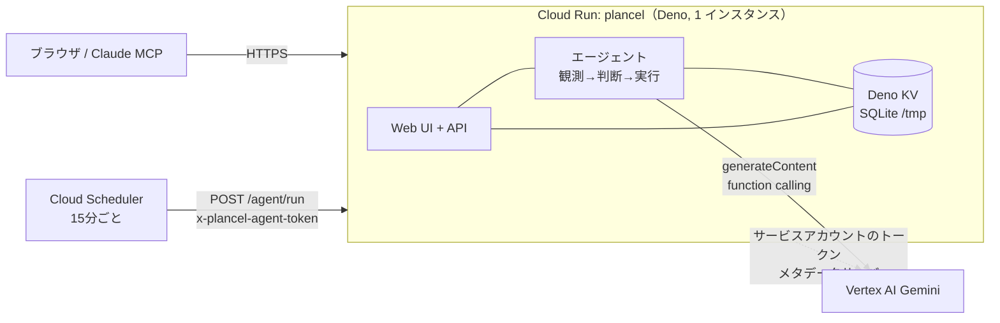

# plancel × Google Cloud — キャンセル・コンシェルジュ

第5回 Agentic AI Hackathon with Google Cloud への出品物。plancel（仮押さえ予約とキャンセル期限の台帳）に、台帳を見張って先回りで提案する **エージェント**を載せ、**Cloud Run** 上で **Gemini（Vertex AI）** を使って動かす。

- 課題: 複数の候補を仮押さえして 1 つに決めたあと、残りのキャンセルを忘れる。キャンセル料は期限を過ぎると段階的に上がる。
- 解決: エージェントが台帳を観測し、「確定済みと重なる候補」「無料期限が 48 時間以内の予約」を見つけ、損失額つきでキャンセルを**提案**する。実行は人が承認したときだけ。

## 構成



| 部品 | 役割 |
| --- | --- |
| Cloud Run | Deno 製サーバ（`src/deploy/main.ts`）を 1 コンテナで動かす。`PORT` を読む。 |
| Vertex AI（Gemini） | エージェントの頭脳。Function Calling で台帳のツールを呼ぶ。鍵は持たず、Cloud Run のサービスアカウントで認証する。 |
| Cloud Scheduler | 15 分ごとに `POST /agent/run` を叩き、全ユーザー分を回す。`Deno.cron` はスケールゼロで当てにならないため。 |
| Deno KV | デモではコンテナ内の SQLite ファイル（`PLANCEL_KV_PATH`）。 |
| Secret Manager | デモ用パスワードとスケジューラの共有シークレット。 |

## エージェントの仕組み

1. **観測**: `list_reservations`（MCP と同じ表示層。JST・`freeUntil`・規定の文章・残り時間・同じプラン/同じ時間帯の他の予約）、`get_reservation`、`estimate_loss`（今キャンセルした場合と次の境界を過ぎた後の金額。台帳の規定計算を使い、モデルには計算させない）。
2. **判断**: 確定済みと重なる未確定候補は「キャンセル候補」、まだ選ぶ段階で期限が迫る候補群は「通知」。
3. **実行**: `propose_cancellation`（理由と施設宛ての下書きつきの**承認待ち**レコードを作る）、`notify_user`（記録のみ。この版ではメール・LINE は送らない）。

守っていること:

- **提案だけ**。エージェントの道具にキャンセル・確定・削除は無い。承認（`POST /api/agent/proposals/:id/approve`）は本人の操作で、台帳の `cancelReservation` を通る。承認時に予約が確定済みになっていたら実行しない。
- 金額・期限はツールが返した値だけ。提案の損失額もサーバ側で計算して保存する。
- 1 回の実行はツール呼び出し最大 8 回、温度 0.1。同じ予約の提案と同じ内容の通知は繰り返さない。
- 判断の記録（観測/判断/実行、引数、結果、最終報告、提案の状態）はユーザーごとに KV へ残り、画面の「エージェントの判断の記録」に出る。
- 台帳が前回から変わらず 6 時間以内なら、定期実行はモデルを呼ばない（15 分ごとに課金されない）。
- ユーザーごとに KV のキーが分かれ、他人の実行・提案には届かない。手動実行は 1 時間 12 回まで。
- Gemini の接続は小さなインターフェースの後ろ。`PLANCEL_VERTEX_PROJECT` があれば Vertex AI、なければ `GEMINI_API_KEY`（両方あれば Vertex を先に試す）。`PLANCEL_AGENT_MODEL` はカンマ区切りで順に試す。一度の実行は最初に答えたモデルのまま続ける（thought signature はモデル間で使えないため）。

HTTP:

| | |
| --- | --- |
| `POST /agent/run` | Scheduler 用。`x-plancel-agent-token`（定数時間比較）。全ユーザーを順に実行。 |
| `POST /api/agent/run` | ログイン中のユーザー自身の実行（画面の「今すぐエージェントを実行」）。 |
| `GET /api/agent/runs?limit=` | 直近の実行（提案つき）と承認待ち。 |
| `POST /api/agent/proposals/:id/approve` / `reject` | 承認（台帳をキャンセル済みに）/ 却下（記録のみ）。 |
| `POST /api/demo/reset` | デモ環境だけ。デモの予約を今日基準で入れ直す。 |

## 環境変数

| 変数 | 内容 |
| --- | --- |
| `PORT` | 待ち受けポート（Cloud Run が設定。既定 8000）。 |
| `PLANCEL_KV_PATH` | KV の SQLite ファイル。Cloud Run では `/tmp/plancel.kv`（Dockerfile の既定）。未設定ならプラットフォームの既定 KV。 |
| `PLANCEL_DEMO` | `1` でデモモード（下記）。 |
| `PLANCEL_DEMO_PASSWORD` | デモアカウントのパスワード（8 文字以上）。コードにも既定値にも無い。未設定だとデモアカウントは作られない。 |
| `PLANCEL_AGENT_TOKEN` | `/agent/run` の共有シークレット。未設定なら `/agent/run` は 503。 |
| `PLANCEL_VERTEX_PROJECT` | 設定すると Vertex AI を使う。 |
| `PLANCEL_VERTEX_LOCATION` | 既定 `asia-northeast1`。`global` も可（ホストは `aiplatform.googleapis.com`）。 |
| `PLANCEL_AGENT_MODEL` | モデル ID、またはカンマ区切りの順序つき一覧。既定 `gemini-flash-latest,gemini-3-flash-preview,gemini-2.5-flash`。 |
| `GEMINI_API_KEY` | Gemini API を使う場合の鍵（Vertex が無い環境、または Vertex の予備）。 |
| `PLANCEL_MAX_USERS` | 新規登録の上限（既定 50）。公開デモでは小さくする。 |

## デモモード

`PLANCEL_DEMO=1` のとき、起動時に `demo@plancel.example`（パスワードは `PLANCEL_DEMO_PASSWORD`、メール確認なし）を作り、**今日を基準にした**サンプルを入れる。

- 記念日ディナー: 鮨 さいとう（確定）、トラットリア アルバ（確定により「要キャンセル」。無料期限は今夜 23:59）、ビストロ ル・ポワン（プラン名なしの同時間帯の候補）。
- 京都旅行（宿）: ホテル鴨川リバーサイド（7日前から20%・前日50%・当日100%。無料期限は明日 23:59）と旅館 花ごろも（候補 2 つで未決）。
- 終わった予約 1 件（エージェントは触らない）。

注意:

- **データはコンテナを再起動すると消え**、起動時に入れ直される（Cloud Run の `/tmp` はメモリ上）。日付は起動時基準なので、数日経ったら画面の「デモデータをリセット」（`POST /api/demo/reset`）で戻す。
- LINE・メール受信・Resend・Google ログイン・開発用自動ログインは、環境変数が残っていても**無効化**される。通知は記録のみで外部には送らない。
- 承認で変わるのは plancel の台帳だけ。施設へのキャンセル連絡は、画面の下書きを使って本人が行う。
- 新規登録は開いたまま（`PLANCEL_MAX_USERS` で上限を絞る）。

## ローカルで動かす

Docker（Rancher Desktop など）:

```sh
docker build -t plancel-gc .
docker run --rm -p 8080:8080 \
  -e PORT=8080 -e PLANCEL_DEMO=1 \
  -e PLANCEL_DEMO_PASSWORD='<8文字以上>' -e PLANCEL_AGENT_TOKEN='<ランダムな文字列>' \
  -e GEMINI_API_KEY \
  plancel-gc
# http://localhost:8080 を開き、demo@plancel.example / 上のパスワードでログイン
```

Docker を使わない場合:

```sh
PORT=8080 PLANCEL_DEMO=1 PLANCEL_DEMO_PASSWORD=... PLANCEL_AGENT_TOKEN=... \
PLANCEL_KV_PATH=/tmp/plancel.kv GEMINI_API_KEY=... deno task deploy:serve
```

スケジューラ経路の確認:

```sh
curl -s -X POST localhost:8080/agent/run -H "x-plancel-agent-token: $PLANCEL_AGENT_TOKEN"
```

無料枠の API キーは 1 分あたりの上限や混雑（503）で止まりやすい。エージェントは「N 秒待て」と言われた短い待ちは待ち、モデルの一覧を順に試すが、Vertex AI の方が安定する。

## デプロイ手順（コマンドの記録。ここでは実行していない）

前提: 専用の Google Cloud プロジェクトを用意し、`PROJECT_ID` と `REGION` を決める。

```sh
export PROJECT_ID=<your-project>
export REGION=asia-northeast1
gcloud config set project "$PROJECT_ID"

# 1. API を有効化
gcloud services enable run.googleapis.com cloudbuild.googleapis.com artifactregistry.googleapis.com \
  aiplatform.googleapis.com secretmanager.googleapis.com cloudscheduler.googleapis.com

# 2. 実行用サービスアカウント（Vertex AI を呼ぶ権限だけ）
gcloud iam service-accounts create plancel-run --display-name="plancel (Cloud Run)"
gcloud projects add-iam-policy-binding "$PROJECT_ID" \
  --member="serviceAccount:plancel-run@$PROJECT_ID.iam.gserviceaccount.com" \
  --role="roles/aiplatform.user"

# 3. シークレット（値は標準入力から。コマンド履歴に残さない）
openssl rand -base64 18 | tr -d '/+=' | gcloud secrets create plancel-demo-password --data-file=-
openssl rand -hex 24                  | gcloud secrets create plancel-agent-token --data-file=-
for s in plancel-demo-password plancel-agent-token; do
  gcloud secrets add-iam-policy-binding "$s" \
    --member="serviceAccount:plancel-run@$PROJECT_ID.iam.gserviceaccount.com" \
    --role="roles/secretmanager.secretAccessor"
done

# 4. ビルドとデプロイ（Dockerfile を Cloud Build でビルドし、Cloud Run へ）
gcloud run deploy plancel \
  --source . \
  --region "$REGION" \
  --service-account "plancel-run@$PROJECT_ID.iam.gserviceaccount.com" \
  --allow-unauthenticated \
  --max-instances=1 --min-instances=1 \
  --memory=512Mi --timeout=300 \
  --set-env-vars "PLANCEL_DEMO=1,PLANCEL_VERTEX_PROJECT=$PROJECT_ID,PLANCEL_VERTEX_LOCATION=$REGION,PLANCEL_MAX_USERS=5" \
  --set-secrets "PLANCEL_DEMO_PASSWORD=plancel-demo-password:latest,PLANCEL_AGENT_TOKEN=plancel-agent-token:latest"

# 5. Cloud Scheduler: 15 分ごとにエージェントを回す
URL=$(gcloud run services describe plancel --region "$REGION" --format='value(status.url)')
gcloud scheduler jobs create http plancel-agent \
  --location "$REGION" \
  --schedule "*/15 * * * *" --time-zone "Asia/Tokyo" \
  --uri "$URL/agent/run" --http-method POST \
  --headers "x-plancel-agent-token=$(gcloud secrets versions access latest --secret=plancel-agent-token)" \
  --attempt-deadline 300s

# 6. 動作確認
curl -s "$URL/healthz"
gcloud scheduler jobs run plancel-agent --location "$REGION"
gcloud run services logs read plancel --region "$REGION" --limit 50
```

メモ:

- `--max-instances=1`: KV がコンテナ内のファイルなので、複数インスタンスに分けるとデータも実行ロックも分かれる。`--min-instances=1` は、審査期間中にデータ（と Scheduler の相手）を消さないため。
- モデルがそのリージョンに無いと 404 になり、`PLANCEL_AGENT_MODEL` の次のモデルに進む。Gemini 3 系は `global` で提供されることが多いので、404 が続くなら `PLANCEL_VERTEX_LOCATION=global` にする。モデルを指定し直すときは、値にカンマを含むので `--set-env-vars "^@^PLANCEL_AGENT_MODEL=a,b@PLANCEL_DEMO=1"` のように区切り文字を変える。
- Scheduler のヘッダにシークレットが入る。より厳しくするなら、Cloud Run を認証必須にして Scheduler に OIDC トークンを付ける（その場合、審査員向けには別の公開サービスが要る）。
- 審査員には、デプロイ URL と `demo@plancel.example`、Secret Manager に入れたパスワードを渡す。
